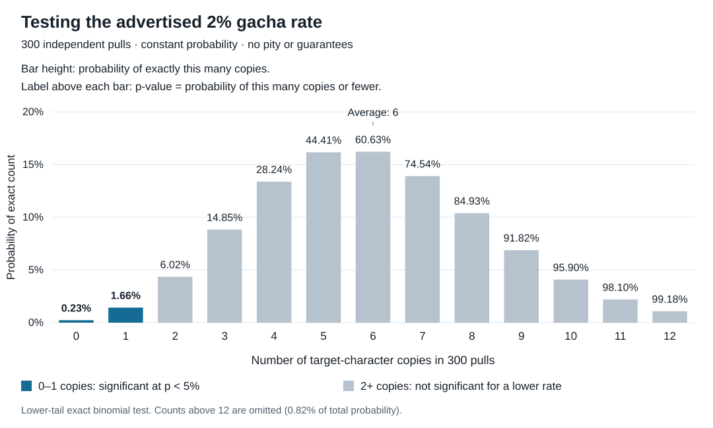

# Understanding p-values through a gacha drop rate

**Main finding:** A p-value asks how often a specified model would produce a result at least as extreme as the observed result. If a game advertises a constant 2% character drop rate, getting very few copies can give evidence against that model, provided the sample and test were chosen fairly. [American Statistical Association (ASA)](https://www.amstat.org/asa/files/pdfs/p-valuestatement.pdf)

**How does the gacha example work?**

- Consider a hypothetical game where each pull independently has a 2% chance of giving the new character, with no pity system or guarantees. The suspicion is that the true chance is **lower than 2%**. The advertised-rate model is the **null hypothesis**, the assumption against which we compare the results. It is a claim temporarily assumed for the test, rather than something already established as true.
- Plan to record 300 pulls and test once at the end. Under the advertised rate, the average across many such experiments would be six copies; an individual experiment need not produce six.
- Suppose the 300 pulls produce only one copy. Ask: **If the rate really were 2%, how often would 300 pulls produce zero or one copies?** Zero counts because it would be an even worse result for someone expecting a 2% rate.
- The calculated answer is **1.66%, or p = 0.0166**. This is a **one-sided exact binomial test**: it counts results in the direction of the suspicion, here fewer copies. The [SciPy binomial-test documentation](https://docs.scipy.org/doc/scipy/reference/generated/scipy.stats.binomtest.html) describes this test and its choice of direction.

- **Bar heights and labels answer different questions.** The one-copy bar has height 1.43%, the chance of exactly one copy. Its label is 1.66%, the chance of zero **or** one. The two-copy label adds the probabilities of zero, one, and two, reaching 6.02%. These values were calculated from the stated binomial model, rather than measured from a game.
- Each label applies if that bar's count were the observed result. Labels are cumulative, so they grow toward the right even as the individual bars eventually shrink. The figure shows counts through 12; the omitted higher counts contain 0.82% of the probability.

**When does the result count as statistically significant?**

- Choose a threshold before seeing the results, such as **p < 0.05**. In this planned 300-pull test, zero or one copies passes that threshold, while two copies does not. The 5% convention does not by itself determine a scientific conclusion. [ASA statement](https://www.amstat.org/asa/files/pdfs/p-valuestatement.pdf)
- One copy gives an observed rate of **1/300 ≈ 0.33%**. A suitable report is: “In 300 pulls, we observed one copy, significantly below the advertised 2% rate in a one-sided exact binomial test, p = 0.0166.” This is a hypothetical result, not an accusation about an actual game.
- The result supports questioning the model; it does not prove intentional rigging or assign a 98.34% probability to rigging. A result above the threshold also does not establish that the advertised rate is correct. [ASA statement](https://www.amstat.org/asa/files/pdfs/p-valuestatement.pdf)

**How do we keep the test trustworthy?**

- Record every eligible pull in the planned sample, rather than collecting only unlucky players' complaints. Keep the planned stopping point; repeatedly checking an ordinary fixed-sample test and stopping when it becomes significant increases false alarms. [Psychonomic Society statistical guidelines](https://featuredcontent.psychonomic.org/psychonomic-society-statistical-guidelines-updated/)
- Check what the advertised 2% refers to. If it means any rare character, includes a pity system, or changes with earlier pulls, the constant independent 2% model does not represent that claim.
- The 300-pull sample is an illustration. It cannot guarantee significance even if the true rate is lower; choosing a sample size for a particular discrepancy remains an open question.

**Why count more than the exact observed outcome?**

- In a quiz example, a student guesses independently on five questions with four choices each. If they get four correct, the p-value for testing performance above guessing includes **four or five correct**, giving 1.5625%. As in the gacha example, the direction of the question determines which additional outcomes count.
- The coin example used both directions because it tested for bias toward either heads or tails. Exactly five heads in ten fair, independent flips has probability about 24.6%, but its two-sided p-value is 100%: every possible head count is at least as far from five as five itself is. The p-value is therefore not generally the probability of the exact observed outcome.

**How is this used in scientific papers?**

- A paper might test a null hypothesis of no difference between two teaching methods. In a hypothetical comparison, one group scored five points higher and the test returned p = 0.02. Under the no-difference model and the test's assumptions, results at least this extreme would occur in about 2% of repetitions. That p-value is stipulated for the example; two group averages alone cannot determine it.
- Read the p-value alongside the **estimated effect** (how large the difference is), its **confidence interval** (the uncertainty around the estimate), and the study design. A small p-value alone does not establish that an effect matters in practice. [Cochrane guidance on interpreting results](https://www.cochrane.org/authors/handbooks-and-manuals/handbook/current/chapter-15)

**Open**

- How many pulls would give a good chance of detecting a true rate of 1% instead of 2%?
- How should the model change for pity systems, or the test change when results are checked as pulls arrive?

The [session record](sessions/2026-11-02-p-value.md) preserves the questions, examples, and limits of what was checked.
