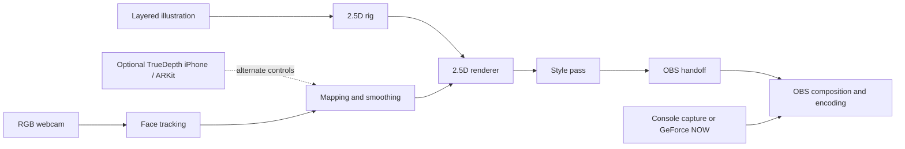

# Project handoff: performance-first 2.5D VTubing on macOS

This is a bootstrap brief for starting a dedicated repository. It records the current product direction, the reasoning behind it, and the first work to do. No implementation or benchmark exists yet.

## Goal

Build a personal VTubing pipeline for an M2 Pro Mac that:

- tracks a face from an RGB webcam, with a compatible TrueDepth iPhone available as an optional offload;
- animates a stylized, front-facing 2.5D character;
- sends the avatar cleanly into OBS;
- leaves enough system capacity for stable streaming at a provisional 1080p60; and
- coexists with a game supplied by console capture or GeForce NOW rather than requiring local game rendering.

The character should suggest volume through layered artwork, constrained deformation, parallax, masks, and stylized shading. Full 3D rotation, rear views, and a conventional skinned humanoid are outside the initial scope.

## Working hypothesis

A deliberately constrained 2.5D puppet can retain the useful perceptual effects of 3D at lower runtime cost than a conventional 3D avatar. It can bake surface detail and much of the lighting into artwork, then compute only the limited motion visible from a front-facing camera.

This is the proposition the project must test, not an accepted result. A complex 2.5D rig can be slower than a simple 3D avatar, and tracking or OBS encoding may dominate either one. Compare complete pipelines under the same streaming workload.

## Decisions already made

| Area | Current decision |
| --- | --- |
| Machine | Apple Silicon Mac with M2 Pro |
| Local workload | Tracking, avatar rendering, OBS composition, and encoding |
| Game source | Console capture or GeForce NOW |
| Representation | Layered, deformable 2.5D illustration rather than conventional 3D |
| Camera range | Front-facing with limited, convincing head turns |
| Visual direction | Painterly or toon-like default; interest in 1-bit and comic-print treatments |
| Delivery target | Provisional 1080p60; resource and latency budgets still need definition |
| Build strategy | Reuse and benchmark existing components; replace only demonstrated bottlenecks |

## Proposed system boundary



Keep these as replaceable boundaries:

1. **Artwork and rig:** layered source art, deformable meshes, parameters, masks, draw order, and secondary motion.
2. **Capture and tracking:** webcam frames or iPhone controls; face pose, landmarks, expressions, confidence, and timestamps.
3. **Mapping:** calibration, ranges, smoothing, dead zones, interpolation, and lost-face behavior.
4. **Renderer:** deformation, compositing, color management, frame pacing, and transparent output.
5. **Style pass:** painterly tone bands, palette treatment, 1-bit dithering, halftones, hatching, ink lines, or stepped motion.
6. **OBS handoff:** the lowest-friction macOS path that preserves quality and alpha or supplies a reliable key.
7. **Instrumentation:** timings and counters shared across every candidate implementation.

The style pass should consume the rendered puppet rather than being embedded throughout its rig. This lets the project compare looks without rebuilding the character or confusing an art choice with a tracking or deformation result.

## First vertical slice

The first milestone is one face control visibly moving one simple puppet in OBS while measurements are captured. It is not a finished character.

1. Write a benchmark contract: target canvas and output size, frame rate, camera input, OBS scene, encoder, test duration, and the resource and latency measures to record.
2. Select one existing 2D puppet setup as the baseline. Live2D plus VTube Studio is the mature proprietary candidate; Inochi2D is the open candidate.
3. Run that baseline with the intended OBS workload before writing a replacement.
4. Build a minimal test puppet with only head pose, blink, and mouth-open controls. Use synthetic controls first so renderer and OBS behavior can be measured independently of tracking.
5. Add local RGB webcam tracking and map its timestamped outputs to the puppet.
6. Add only one visual treatment at a time, recording its frame-time and image-quality effect.
7. Repeat the sustained test with iPhone tracking if local inference consumes enough of the budget to make offload relevant.

If the existing baseline passes the contract, keep it. If it fails, the measurements should identify whether to replace tracking, mapping, rendering, the style pass, or the OBS transfer.

## Benchmark contract to define

Record both the user-visible result and the cost of producing it:

- motion-to-display latency, including capture, inference, mapping, rendering, transfer, and OBS;
- tracking inference time and output rate;
- renderer CPU and GPU time, frame pacing, and missed frames;
- OBS render lag, encoding lag, output drops, and audio/video sync;
- process and system CPU, GPU, ANE where observable, memory, and energy use;
- temperature, throttling symptoms, and stability during a sustained test; and
- recovery after camera loss, tracker loss, sleep, or an OBS restart.

Do not choose arbitrary pass/fail numbers merely to fill the document. Establish them from the intended stream and a short baseline run. Keep the test scene and sampling method fixed so results remain comparable.

## Candidate components

These are starting points, not locked choices:

- **Rig authoring and runtime:** Live2D Cubism or Inochi2D.
- **Local tracking:** MediaPipe Face Landmarker initially; a Core ML-native path only if profiling justifies it.
- **Tracking offload:** ARKit blendshapes and pose from a compatible TrueDepth iPhone.
- **Custom rendering:** a small Metal renderer only if an existing runtime misses the performance, visual, or OBS-integration contract.
- **OBS transfer:** window capture plus a key, NDI, Syphon through a compatible path, or another transparent-output mechanism. Test the actual path on macOS before adopting it.

The evidence and links behind these candidates are in [the learning note](vtubing-pipeline-tech-stack.md). The fuller question-by-question record is in [the session record](sessions/2026-10-24-vtubing-pipeline-tech-stack.md).

## Visual modes to explore

Start with one readable default before treating style effects as a feature matrix:

1. **Painterly toon:** restrained tone bands and hand-painted textures, guided by the *Monster Hunter Stories 3* and *Breath of the Wild* references.
2. **1-bit:** grayscale lighting reduced through a controlled dither pattern, guided by *Return of the Obra Dinn*.
3. **Comic print:** line work, halftone or hatch masks, controlled color offsets, and optional stepped animation, guided by *Into the Spider-Verse*.

Whether these become one hybrid house style or switchable modes is unresolved. Each effect needs to preserve transparent edges and be benchmarked separately.

## Non-goals for the first repository milestone

- A full 3D or VRM avatar system.
- Side and rear views or unrestricted camera rotation.
- Local rendering of a game.
- Full-body motion capture.
- A polished character editor.
- Replacing every third-party component before profiling it.
- Reproducing another production's proprietary shader exactly.

## Open decisions

- [ ] Define whether the puppet includes shoulders and upper-body sway.
- [ ] Decide whether proprietary tools are acceptable for the baseline and for the final stack.
- [ ] Choose the webcam, capture resolution, and capture rate.
- [ ] Choose the first existing baseline.
- [ ] Define the provisional latency and sustained resource ceilings.
- [ ] Choose the first OBS handoff to test.
- [ ] Decide whether visual treatments are hybrid or switchable.
- [ ] Choose implementation languages and dependencies only after the first profiling result narrows the custom work.

## Suggested repository bootstrap

```text
README.md                 Project goal, status, and quickest reproducible demo
HANDOFF.md                This decision and continuation brief
docs/design-context.md    Durable version of the learning note
docs/benchmark-contract.md
benchmarks/               Fixtures, result schema, and dated measurements
assets/sample-puppet/     Redistributable minimal test artwork and rig
src/                      Added only after component boundaries are chosen
```

Copy this document and the learning note into the new repository. Preserve the distinction between observations, proposed designs, and measured results. Every benchmark should record the machine, macOS and OBS versions, input, scene, encoder, duration, and component revisions.

## Next action

Define the benchmark contract and pick one existing baseline. Run it with OBS on the M2 Pro before choosing a custom technology stack. That result determines which part of the pipeline, if any, deserves a DIY implementation.
