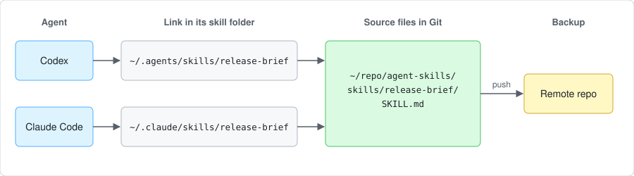

# Installing and Sharing Agent Skills

Folder locations and installer behavior checked on 2026-09-29. The personal-repository example and its maintenance guide were checked on 2026-11-03.

Put the skills you want an agent to use in that product's skill folder, either by copying, linking, or installing them. The right route depends on who edits the skill and who needs to use it.

This guide assumes the skills already live somewhere; to lay out that repository, see [Organizing skills in a repository](organizing-skills.md). For product-specific discovery and permissions, see [Product differences](provider-differences.md).

## Choose a route

| Your situation | Route | Where to read about it |
| --- | --- | --- |
| You want selected skills from a collection, yours or someone else's | Install them with a CLI | [Install selected skills from a collection](#install-selected-skills-from-a-collection) |
| You edit your own skills and use them across agents | Link the agents to your Git checkout | [Maintain a personal checkout as the installation](#maintain-a-personal-checkout-as-the-installation) |
| People outside your repository should be able to find and install them | Publish through a product or directory | [Share through a product or public directory](#share-through-a-product-or-public-directory) |
| You want to hand one skill to a Codex user as files, or install it from GitHub | Export the folder or use Codex's installer | [Exporting and installing a skill for Codex](#exporting-and-installing-a-skill-for-codex) |

## Install selected skills from a collection

Vercel's `skills` CLI can list a repository's skills and install selected names. In these examples, replace `your-name/agent-skills` with your repository. Run installation commands from the target project's root:

```bash
npx skills add your-name/agent-skills --list
npx skills add your-name/agent-skills --skill release-brief --agent codex
npx skills add your-name/agent-skills --skill release-brief --skill incident-brief --agent cursor
```

Project installation is the default. Add `--global` for a personal installation across projects. The CLI accepts public or private Git repositories and local folders; private repositories need working credentials. [CLI options](https://github.com/vercel-labs/skills#options)

For a reviewed revision, check out that tag or commit locally, then install selected skills from its local path:

```bash
npx skills add /absolute/path/to/agent-skills --skill release-brief --agent codex
```

Choose between **links** and **copies**. The CLI's symlink installation points to its shared local copy; `--copy` gives each agent independent files. These installations are separate from the source Git checkout: updating the repository does not by itself refresh the installed files. Agree on an update process and retest affected skills. [Installation methods](https://github.com/vercel-labs/skills#installation-methods)

For a collection you actively maintain yourself, you can instead link each skill directly to your source checkout. The next section explains how that changes editing and backups.

## Maintain a personal checkout as the installation

A direct symlink makes an agent read the files in your Git checkout, so an edit through the link changes the source file and Git sees it there. Several agents can link to the same checkout, which leaves no second editable copy to keep in sync.



Both links resolve to the same folder, so a change made through either one is the same change. Committing and pushing to the remote are separate steps, and they are what make the files a backup.

[pomodorozhong/skills](https://github.com/pomodorozhong/skills) is a working example that serves Codex and Claude Code from one checkout. Its [maintenance guide](https://github.com/pomodorozhong/skills/blob/main/docs/maintaining.md) has the commands for setup, imports, daily edits, and undoing a link run. This section covers the choices to make when you adapt that approach.

Codex's personal discovery folder is `~/.agents/skills`; Claude Code's default is `~/.claude/skills`. Both document support for individual skill folders that are symlinks to directories elsewhere on disk. [Codex skill locations](https://learn.chatgpt.com/docs/build-skills#where-codex-loads-local-skills), [Claude Code skill locations](https://code.claude.com/docs/en/skills)

Link each skill individually, leaving the parent discovery folders available for other installations and product-managed entries.

### Choose links or installed copies

| Approach | Where edits land | How another machine gets the change |
| --- | --- | --- |
| Link directly to your Git checkout | In the source repository, including edits through an agent's skill path | Pull the saved revision and recreate links when skill folders change |
| Install independent copies | In the installed copy unless you edit the source explicitly | Reinstall the selected skills from the reviewed source revision |

Links suit a collection you actively maintain on your own machine. They depend on the checkout staying at the linked path and being accessible to the agent, so moving the checkout means repairing the links. Copies suit environments where symlinks or access to the source checkout are a poor fit, though you then need to decide how source edits reach those installations.

### Keep the linked checkout on a reviewed version

Agents read the linked files, including uncommitted edits, so switching branches in that checkout changes the skills they run. Keeping the linked checkout on reviewed work and developing in a separate worktree stops an unfinished change from going into use.

### Decide which versions to share

Before importing existing installations, compare versions with the same name. Different instructions or executable permissions can change behavior. Merge the changes you want if both agents should share one version. When instructions depend on a product's tools or invocation syntax, keep distinct versions and install each only for its intended agent.

The pomodorozhong/skills example chooses one shared version per skill and links each one into both agents, so agent-specific variants would need a different installation plan.

### Back up the files and restore the installation

Commit the source files you want to preserve and push them to your remote. A symlink or installer lock file cannot replace the skill's actual files. Maintain your own source files in Git, record the sources and reviewed revisions of third-party skills separately, and reinstall bundled, synced, and plugin skills through the product that manages them.

A restore needs both the source files and the installation plan: clone the repository, recreate links or copies, reinstall recorded dependencies, and try a sample request in each intended agent. A skill appearing in a selector checks discovery; a sample request checks whether its instructions and helpers work in that environment.

## Share through a product or public directory

Git stores the source files. A plugin or marketplace provides another way for people to install them. OpenAI recommends plugins for distributing reusable skills beyond one repository; a plugin can contain one or several skills and optional connectors. See the [Codex plugin packaging guide](https://developers.openai.com/plugins/build/plugins) and [OpenAI's example repository](https://github.com/openai/plugins).

Cursor has a team marketplace for sharing skills. Other products have their own packaging and upload rules; see [Product differences](provider-differences.md). [Cursor team sharing](https://prod.cursor.com/help/customization/skills)

[skills.sh](https://skills.sh/) helps people find public skills through Vercel's ecosystem. Treat a listing as a way to find candidates. Review the instructions, scripts, dependencies, and licenses before installation.

## Exporting and installing a skill for Codex

### Export the whole skill folder

Include `SKILL.md` and every local file the skill uses, with their relative paths intact. Export one skill folder rather than the whole collection. Remove private examples, secrets, and machine-specific paths before sharing.

From a project containing `.agents/skills/release-brief`, these commands create an export folder and an archive:

```bash
mkdir skill-export
cp -R .agents/skills/release-brief skill-export/release-brief
tar -czf skill-export/release-brief.tar.gz -C skill-export release-brief
```

Choose a new export folder if `skill-export` already exists. For a collection repository, replace the copy source with `skills/release-brief`. The archive should contain `release-brief/SKILL.md` and supporting files. Unpack it before manual installation. These are file-copy commands, not a Codex export command.

### Install by copying the folder

Choose the scope using [Codex's documented discovery locations](https://developers.openai.com/codex/skills#where-codex-loads-local-skills):

| Scope | Codex's documented destination | Use it when |
| --- | --- | --- |
| Project | `.agents/skills/release-brief/` | The skill belongs with that project |
| Personal | `~/.agents/skills/release-brief/` | You want it across projects |

From the target project's root, copy an unpacked export into the project:

```bash
mkdir -p .agents/skills
test ! -e .agents/skills/release-brief && cp -R skill-export/release-brief .agents/skills/release-brief
```

Or copy it into your personal folder:

```bash
mkdir -p "$HOME/.agents/skills"
test ! -e "$HOME/.agents/skills/release-brief" && cp -R skill-export/release-brief "$HOME/.agents/skills/release-brief"
```

Change the source path if the export is elsewhere. The `test` stops the copy when an installation already exists; compare the versions before replacing it.

### Install from GitHub with Codex's installer

Ask the built-in installer for a specific folder and destination:

```text
$skill-installer Install release-brief from https://github.com/your-name/agent-skills/tree/main/skills/release-brief into ~/.agents/skills.
```

Replace the example URL with your repository. The published installer defaults to `$CODEX_HOME/skills`, usually `~/.codex/skills`, which differs from the personal discovery folder documented above. Giving the destination explicitly makes the intended location clear. Its helper supports `--dest`, `--ref` for a tag or commit, and multiple `--path` values for several skills. Ask for a reviewed revision if you need a fixed version. [Published installer instructions](https://github.com/openai/skills/blob/main/skills/.system/skill-installer/SKILL.md)

### Check the installation

In Codex CLI or the IDE extension, open `/skills` or mention `$release-brief`. If it is missing, check the installed path and `SKILL.md`; restart Codex if needed. Then try a small task with sample records. Being listed proves discovery; following the steps on a sample task checks behavior. [Codex skill guide](https://developers.openai.com/codex/skills)

## Sources

- [Codex: Build skills](https://developers.openai.com/codex/skills)
- [Codex skill locations](https://learn.chatgpt.com/docs/build-skills#where-codex-loads-local-skills)
- [Claude Code skill locations](https://code.claude.com/docs/en/skills)
- [Cursor: Skills](https://prod.cursor.com/help/customization/skills)
- [Vercel `skills` CLI](https://github.com/vercel-labs/skills)
- [OpenAI's current plugin examples](https://github.com/openai/plugins)
- [Published skill-installer instructions](https://github.com/openai/skills/blob/main/skills/.system/skill-installer/SKILL.md)
- [Codex plugin packaging](https://developers.openai.com/plugins/build/plugins)

The maintenance advice in this guide is a recommendation. Export and project-copy commands were checked with temporary files; no skill was installed into Codex. Personal-skill discovery and invocation were not tested in running agents. Product and installer behavior may change.
