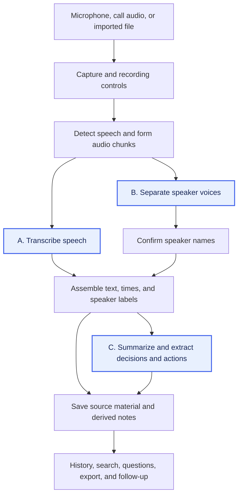

# AI Meeting Notes

> The tool is now built in [meeting-recap](https://github.com/pomodorozhong/meeting-recap). See [Where the work continues](#where-the-work-continues).

This note examines how to produce meeting notes locally on a **MacBook Pro with M2 Pro and 16 GB unified memory**. The first test was whether a model can produce an accurate transcript and reliably distinguish the speakers in a meeting recording, because those outputs provide the material for summaries, decisions, and action items. In a [recording trial](https://github.com/pomodorozhong/meeting-recap/blob/main/docs/experiments/2026-10-24-hushscribe-trial.md) on one real call, the setup first chosen from the source review could not separate the speakers. Whisper Large v3 with Chinese forced, plus FluidAudio’s Sortformer diarizer, the model that decides who is speaking when, then produced a usable transcript and kept the three speakers apart [over two full recordings](https://github.com/pomodorozhong/meeting-recap/blob/main/docs/experiments/2026-10-24-full-recordings.md).

We extracted the [Feature catalogue](feature-catalogue.md) from the documented workflows of [established paid AI meeting assistants](product-coverage.md): Notion, Amie, and Spellar. Its 22 features describe the intended behavior and common failures. They give the investigation a reference: which features each pipeline step supports, how errors affect later outputs, and what additional work a local implementation needs.

## General pipeline and its bottlenecks

The [open-source local solutions](open-source-pipelines.md) **Meetily, HushScribe, VOA, and Tacet** provide implementations to inspect. Their documented pipelines capture audio, split it into speech segments, turn speech into text, and produce notes. Speaker processing adds labels to the text where supported. Saving these outputs makes them available for history, search, export, and follow-up features.

The apps schedule that work differently. HushScribe describes separating speakers after the call and generating summaries on request; Tacet describes speaker processing alongside transcription and analysis during the call. This changes when labelled text and notes become available, and which models must run together. The [source overview](open-source-pipelines.md#observed-pipeline-patterns) records the documentation and selected source files inspected on **2026-10-06**. The [configuration review](open-source-pipelines.md#confirmed-models-runtimes-and-settings), inspected on **2026-10-08**, confirms the main model paths and requirements; it did not cover the wider feature set.

Consider this fictional exchange in a two-person meeting:

> Mei: “Let’s launch on Monday, not Friday.”
>
> Lin: “Agreed. I’ll update the checklist.”

Transcription needs to preserve the words, including “not.” Speaker separation needs to keep the two voices distinct so “I’ll update” stays attached to Lin’s turn. It can label them “Speaker 1” and “Speaker 2”; attaching their names requires confirmed identity information. The diagram connects those jobs to the later notes. It combines the observed paths into a general model; each app may run the steps in a different order or leave some out.

A bottleneck is a step that holds up the work that follows it. For example, if transcription takes longer to process speech than new speech takes to arrive, unfinished audio accumulates and the live text falls behind. Several models running together can also exceed the available memory. Processing speakers or summaries after the call reduces the work that must run at once, at the cost of waiting for those outputs.

Speed alone does not make the output useful. If capture misses Mei’s sentence, the transcript has no launch decision to pass to the summary step. If the text loses “not,” or the speaker labels move Lin’s words to Mei, later notes can report the wrong meaning or task owner. Keeping the text’s order, times, and speaker labels makes these errors easier to trace. The [stage-to-feature map](feature-catalogue.md#pipeline-steps-and-feature-impact) lists the starting dependencies for all 22 features.

## Why these steps can be bottlenecks and why they matter

**A. Transcription** produces the text (**MN-04**) that the other steps read. It must preserve the meeting's languages, names, technical terms, and meaning. In the exchange above, losing the word “not” changes the launch statement. A model that gets the words right but processes the recording too slowly may also be impractical.

**B. Speaker separation and identity** keep each part of the text attached to a voice (**MN-06**). Overlapping speech or several voices picked up by one microphone can cause speakers to be merged or labelled inconsistently. That matters even when the words are correct: Lin's “I'll update the checklist” needs to stay attached to Lin's turn. Attaching a person's name (**MN-07**) requires confirmed identity information as well as voice separation.

**C. Summaries, decisions, and actions** use that text and speaker context to produce the notes (**MN-08**–**MN-10**). In the example, the expected decision is a Monday launch and the task belongs to Lin; no task deadline was stated. Errors in A or B can change those outputs before the summary model reads them. Long transcripts can also increase processing time and memory use at C. This makes transcription and speaker separation a useful first check, while leaving summary quality as a separate question.

The [source observations](open-source-pipelines.md#what-these-patterns-tell-us) provided the starting options for that check. The rule was to stop testing once a model reliably distinguished speakers and produced a good transcript on this Mac, and otherwise to let the actual failures choose the next experiment.

## What the recording trial found

The trial started with a ten-minute excerpt of a three-person online call in Mandarin with English product terms, recorded by a meeting app as one mono track. To check the speaker labels, the author listened to short clips around speaker changes and named who spoke in each.

**The setup chosen from the source review did not separate the speakers.** The [configuration review](open-source-pipelines.md) had selected a HushScribe source build with Whisper Large v3, language detection enabled, and FluidAudio’s offline Community-1 diarizer. In the [HushScribe recording trial](https://github.com/pomodorozhong/meeting-recap/blob/main/docs/experiments/2026-10-24-hushscribe-trial.md), the transcript mostly preserved the meaning, with misheard names, a few wrong words, and short invented lines in other languages where language detection ran on very short chunks. The diarizer, however, put almost all speech from the three people under one label.

**A different diarizer kept the speakers apart on the same excerpt.** The [diarizer comparison](https://github.com/pomodorozhong/meeting-recap/blob/main/docs/experiments/2026-10-24-diarizer-comparison.md) tried other Community-1 settings and other local diarizers. On 14 listened clips containing 30 speaker turns, no Community-1 setting recovered more than 19 turns, while FluidAudio’s Sortformer recovered 29. A [transcription comparison](https://github.com/pomodorozhong/meeting-recap/blob/main/docs/experiments/2026-10-24-transcription-variants.md) settled the other half: forcing Whisper to Chinese removed the invented foreign-language lines, and English product terms still came through.

**The combination held up over the full call.** The [full-recording run](https://github.com/pomodorozhong/meeting-recap/blob/main/docs/experiments/2026-10-24-full-recordings.md) used Whisper Large v3 with Chinese forced and Sortformer on both recordings of the call, 22 and 65 minutes long. Across those 87 minutes, Sortformer kept one label each for two participants and split the third participant’s voice across two labels, which a naming step can merge. On the 65-minute recording, transcription took 14 minutes and speaker separation 26 minutes, each under 1.6 GB of peak memory. That met the stopping rule, so testing more models stopped there.

These results come from one call and from 34 clips checked by one listener, so they show the kinds of errors rather than error rates. They do not cover summaries, live labels during a call, or calls with more than four speakers, which is Sortformer’s limit.

## Where the work continues

Building a working tool, starting with a pipeline for saved recordings, continues in [meeting-recap](https://github.com/pomodorozhong/meeting-recap). The [investigation plan](https://github.com/pomodorozhong/meeting-recap/blob/main/docs/investigation-plan.md) and the [review guide](https://github.com/pomodorozhong/meeting-recap/blob/main/docs/review-guide.md) moved there, and the trial record and the experiment code were written there. This topic keeps the background research: the feature catalogue, the paid-product comparison, and the review of open-source pipelines.

Each recording trial report gives the pinned setup, runtime, and scores behind the results above:

- [HushScribe recording trial](https://github.com/pomodorozhong/meeting-recap/blob/main/docs/experiments/2026-10-24-hushscribe-trial.md)
  - Did the setup chosen from the source review produce a usable transcript and reliable speaker labels?
- [Diarizer settings and models](https://github.com/pomodorozhong/meeting-recap/blob/main/docs/experiments/2026-10-24-diarizer-comparison.md)
  - Does a known speaker count or another Community-1 setting fix the merged voices, and do other local diarizers do better?
- [Attaching speaker labels to transcript text](https://github.com/pomodorozhong/meeting-recap/blob/main/docs/experiments/2026-10-24-label-attachment.md)
  - How much does the method of tying text to speaker labels matter?
- [Transcription settings and models](https://github.com/pomodorozhong/meeting-recap/blob/main/docs/experiments/2026-10-24-transcription-variants.md)
  - Which language setting, prompt, or model gives the most usable Chinese + English transcript?
- [Both full recordings](https://github.com/pomodorozhong/meeting-recap/blob/main/docs/experiments/2026-10-24-full-recordings.md)
  - Does the chosen combination hold up over 87 minutes in time, memory, and label stability?

## Documents in this topic

- [Feature catalogue](feature-catalogue.md)
  - Which 22 behaviors should a meeting-notes tool provide, and what are their common failures?
  - Which pipeline step supports each feature?
- [Product coverage](product-coverage.md)
  - How do Notion, Amie, and Spellar document each catalogue feature?
- [Paid meeting-notes baseline](paid-baseline.md)
  - What do the paid products cost, and what limits, languages, and processing boundaries do they state?
- [Local pipeline sources](open-source-pipelines.md)
  - How do Meetily, HushScribe, VOA, and Tacet turn audio into notes?
  - Which models, runtimes, and settings do they use, and why was HushScribe chosen for the trial?

## Sources

The catalogue comes from the [dated paid-product research](paid-baseline.md#sources). Pipeline observations come from the primary project documentation and selected source files listed in [Local pipeline sources](open-source-pipelines.md#sources), initially inspected on **2026-10-06**, with configuration and artifact checks on **2026-10-08**. The combined diagram, feature dependencies, and choice of first experiments are our analysis of those sources. The trial results summarize the experiment reports in [meeting-recap](https://github.com/pomodorozhong/meeting-recap) listed under [Where the work continues](#where-the-work-continues).

[Back to all topics](../../README.md)
