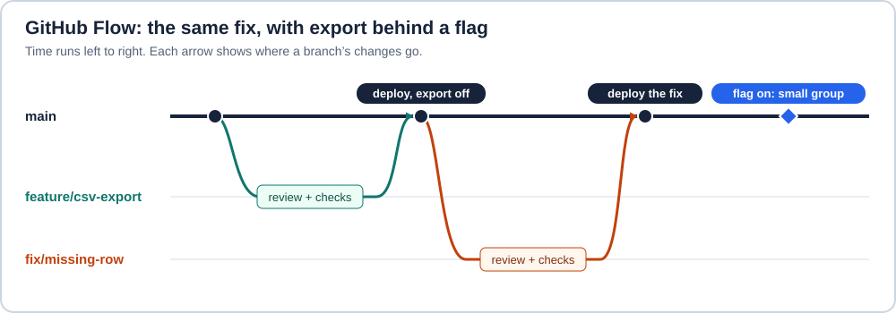

# Choosing a Git workflow when releases overlap

A team is testing CSV export for version 1.5 when someone discovers that 1.4 drops the last line item when it saves an order. Which commit should receive the fix? If production follows the latest tested commit, one short branch may be enough. If customers run 1.4 while 1.5 is being certified, the team needs a way to build both versions. Release timing explains much of the difference between Git Flow and GitHub Flow.

A branch is a movable name for a commit. A tag can give a particular commit a lasting release name. **Integration** brings code together, **deployment** puts a build in an environment, and **release** makes a capability available to its users. Continuous integration (CI) runs checks on changes as developers bring them together. Deployment automation can then promote the tested build. [Git branches and commits](https://git-scm.com/book/en/v2/Git-Branching-Branches-in-a-Nutshell)

## Git Flow keeps a place to stabilize a release

In Vincent Driessen’s original model, `develop` collects changes for a future release. A short-lived release branch accepts fixes while new features continue on `develop`. The production branch, called `master` in the original, records releases. [Driessen’s model and his 2020 retrospective](https://nvie.com/posts/a-successful-git-branching-model/)

Follow the example in time. Review the export into `develop`, cut `release/1.5`, and give testers a build from that branch. When the missing row is reported, start the fix at `v1.4.0`. Test it against 1.4, merge it into `master`, tag `v1.4.1`, and ship that build. Bring the fix into the active 1.5 release branch too. When 1.5 ships, merge its stabilization changes back into `develop`. If no release branch is active, bring the hotfix into `develop` directly. The second destination is what keeps the bug from returning in the next version.

## GitHub Flow keeps the default branch ready to deliver

GitHub documents a shorter loop. Branch from the default branch, make a focused change, open a pull request (PR), respond to review and checks, merge, then delete the topic branch. A team can deploy a candidate to a preview environment before merging or deploy the tested revision afterward. Hosting a repository on GitHub leaves the team free to use either branching model. [GitHub Flow](https://docs.github.com/en/get-started/using-github/github-flow)

In this version of the example, the export code has already passed integration tests. A **feature flag** selects the export path at runtime. Deploy the row fix from `main` with export still disabled, then enable export for a small group when it is ready. A feature branch keeps unfinished code out of the integration branch. A release flag lets users keep the old behavior even when the deployed binary contains the new code. A team can use both in either workflow. Test both meaningful flag states, choose who can enable it, and remove the old path after rollout. Switching the flag off can stop new exports. It cannot restore a row that was already dropped. [Pete Hodgson’s feature-toggle patterns](https://martinfowler.com/articles/feature-toggles.html)

## What work does each choice create?

| Decision | Git Flow | GitHub Flow |
| --- | --- | --- |
| Development and review | Target features at `develop` and stabilization fixes at the release line. Reviewers need to know which version they are testing. | Target a series of small changes at `main`. Rapid review and reliable checks keep it deliverable. |
| Integration and CI | Test the release branch and the places where fixes are merged back. Longer divergence gives conflicting edits more time to accumulate. | Integrate frequently. CI still needs to test the result of combining changes, especially when several PRs pass against the same older base. |
| Release and deployment | Tag a tested release commit and promote its artifact on the release schedule. The next train can be under development meanwhile. | Deploy a revision that passed the checks as often as the product allows. Tags, a store submission, or a flag can define a separate release date. |
| Maintenance and rollback | Backport selected fixes to each supported line. A previous tag identifies a candidate rollback build. | Revert a faulty change on `main`, roll back a deployed artifact, or disable the feature when possible. An older supported binary may still need a maintenance branch. |

Rollback also depends on data compatibility. A restored binary must still be able to read the database or file format in use.

### Name the branch for the next person who needs it

`feature/csv-export` describes work to integrate. `release/1.5` tells a tester where stabilization fixes belong. `fix/orders-318-missing-row` illustrates a team convention for linking a short-lived branch to a ticket. A team can also use plain `csv-export`. Choose a consistent spelling that helps review or automation, and document any prefixes that trigger jobs. Git checks ref syntax, for example with `git check-ref-format --branch feature/csv-export`. Creating a `release/` prefix gives it no special Git behavior. After merging, the PR and release tag can carry the durable record. [Git’s branch-name rules](https://git-scm.com/docs/git-check-ref-format)

### Choose the release lines before configuring GitHub

- **One continuously deployed service.** Short branches suit a team that can review, test, and recover quickly. DORA found an association between frequent integration, few active branches, and delivery performance. Its research concerns those practices, so it cannot establish that changing a workflow name will improve a particular team. [DORA’s trunk-based development research](https://dora.dev/capabilities/trunk-based-development/)
- **Mobile, desktop, or scheduled releases.** Cut a stabilization branch only when store review, signing, or a fixed shipment date overlaps work on the next version. This hybrid keeps short feature branches and adds a second integration target for the overlap.
- **Libraries with several supported versions.** Tag releases on the main line and keep a maintenance branch per supported major when patches are needed. Record which lines received a fix and run each line’s tests. Canonical Git Flow’s single production tip alone cannot identify every supported version.
- **Releases that require formal approval.** Decide whether approval applies to the change or to the deployment of a particular artifact. As of November 2026, GitHub branch protections can require reviews and passing checks. A merge queue tests changes against the target and changes ahead in the queue. Environment protection rules can gate a deployment separately. Availability depends on the repository and plan. [Protected branches](https://docs.github.com/en/repositories/configuring-branches-and-merges-in-your-repository/managing-protected-branches/about-protected-branches) · [Merge queues](https://docs.github.com/en/repositories/configuring-branches-and-merges-in-your-repository/configuring-pull-request-merges/managing-a-merge-queue) · [Deployment environments](https://docs.github.com/en/actions/concepts/workflows-and-actions/deployment-environments)

To change workflows, inventory the versions still receiving fixes and identify the commit actually deployed for each one. Keep those refs while moving new work to the chosen integration branch. Update PR targets, required checks, and deployment triggers together. Rehearse the missing-row fix against the oldest supported version. The rehearsal should produce a shippable patch there and a passing regression test on the next release line.
